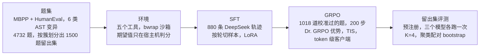

# agentic-rl

用 SFT 和自己实现的多轮 GRPO，训练 Qwen3-1.7B 在沙箱里用五个工具修复 Python 代码里的单个 bug，并在预注册的留出集上评测。

**留出集结果**：1500 题，每题 4 次，严格解出率指隐藏用例全过。

| 基座 Qwen3-1.7B | SFT-v1 | GRPO（第 150 步） |
|---|---|---|
| 13.9% | 47.1% | 60.3% |

- GRPO − SFT：**+13.2 个百分点**，95% 区间 [11.7, 14.7]。
- SFT − 基座：**+33.2 个百分点**，95% 区间 [30.4, 36.1]。
- 区间来自按 273 个 bug 来源函数的聚类配对 bootstrap，10000 次，seed 0。
- 出处：`docs/FINAL-REPORT.zh-CN.md` 第 5.1 节，数字由 `scripts/closeout/verify_heldout.py` 从原始记录复算。



完整报告：[docs/FINAL-REPORT.zh-CN.md](docs/FINAL-REPORT.zh-CN.md)。报告里写了背景（前置项目 A5 的零结果）、做法、过程中修好的问题、局限和花费。

局限：只测了一个模型规模和合成的单 bug 题，没有在 SWE-bench 这类真实仓库任务上验证；GRPO 只跑了一组超参数。详见报告第 7 节。

环境：WSL / Linux，Python 3.12。`uv sync` 安装依赖，`uv run pytest -q` 跑测试。训练和推理用另外两个 venv（`~/.venvs/train`、`~/.venvs/vllm`），见下面"服务器上怎么跑"。

## 项目历史

| 阶段 | tag | 一句话结论 | 记录 |
|---|---|---|---|
| 1 环境和题集 | `phase1-tasks-v1`（`436d8db`）、`phase1-env-v1`（`14c155e`） | 4732 道题和环境冻结。诊断扫描里 Qwen3-1.7B 解出率 17.7%，是能在 11 GB 卡上跑的模型里最好的；DeepSeek 89.5%，说明题在 10 轮内解得出 | `docs/plan/CHECKPOINT-1D.md` |
| 2A SFT | `phase2-grader-v1`（`a73e4e0`）、`sft-v1`（`576d202`） | 880 条轨迹按轮切样本做 LoRA SFT，dev 严格解出率从 20.3% 到 53.5%，配对差 +33.3 [24.8, 41.8] | `docs/plan/CHECKPOINT-2A.md` |
| 2C 租卡前的本地准备 | `grpo-tasks-v1`（`2f847cb`） | token 级客户端和 GRPO 实现；回放比对 64/65 一致；校准后留下 1018 道解出 1–3 次的题 | `docs/plan/PROGRESS.md`"Phase 2C" |
| 3 A800 上的 GRPO | `phase3-grpo-v1`（`cf3ebc5`） | 200 步，20 小时 57 分，没有触发停止条件；按预注册规则选第 150 步；留出集上比 SFT 高 13.2 个百分点 | `docs/plan/CHECKPOINT-3.md` |
| 4 收尾 | `final-v1` | 本地复算全部报告数字，CHECKPOINT-3 有两处监控指标的文字描述不对，已加勘误；写最终报告、README 和服务器脚本 | `docs/plan/CHECKPOINT-4.md` |

各阶段的计划和每一步的记录在 `docs/plan/`，进度流水在 `docs/plan/PROGRESS.md`。

## 服务器上怎么跑

阶段 3 在一台 A800-SXM4-40GB 上跑（Ubuntu 24.04，驱动 595.84）。下面是那次踩过的坑，下次租机照着做。来源是 `docs/plan/PROGRESS.md`"阶段 3 · 第 1 步"到"第 3 步"，以及 `docs/plan/CHECKPOINT-3.md`"遇到的问题"。

1. **驱动**：选驱动 580 以上的镜像（`nvidia-smi` 里 CUDA Version 至少 13.0）。torch 2.13.0 和 vLLM 0.31.0 没有能在 CUDA 12.x 上用的官方组合，`setup.sh` 遇到更低的驱动会停下（`scripts/server/sync.md`）。
`scripts/server/setup.sh` 在装任何东西之前会先检查第 2–4 条，不满足就停下并打印修法。脚本本身不改系统配置，要 root 的修法由你手动执行。这三项检查只在本地测过（`tests/test_server_scripts.py`），还没在服务器上跑过。

2. **用非 root 用户**：沙箱用 `RLIMIT_NPROC` 挡 fork 炸弹，root 不受这个限制，防 fork 炸弹的 2 项测试会失败。先用 root 建一个普通用户，之后所有命令都以这个用户执行。root 只用来装系统包：

   ```bash
   adduser --disabled-password --gecos "" arl
   su - arl
   ```

3. **bwrap 的 AppArmor 规则**：Ubuntu 24.04 默认不让非特权进程创建 user namespace，bwrap 起不来，沙箱测试会被跳过。
   - 规则在 `scripts/server/bwrap-userns.apparmor`。用 root 安装：`install -m 644 scripts/server/bwrap-userns.apparmor /etc/apparmor.d/bwrap-userns && apparmor_parser -r /etc/apparmor.d/bwrap-userns`。
   - 验证：以普通用户跑 `uv run pytest -q tests/test_sandbox.py`，要求 25 passed、0 skipped（13 项 bwrap 检查一项都不能跳过）。
4. **`python3.12-dev`**：venv 用的是系统的 `/usr/bin/python3.12`。triton 运行时要编译 `cuda_utils.c`，没有 `Python.h` 时 GradScaler 那条路径的 GPU 测试会失败。用 root 装：`apt-get install -y python3.12-dev`。
5. **venv 的 bin 目录放进 PATH**：vLLM 预热时 FlashInfer 要 JIT 编译采样 kernel，会调用 `ninja`。`ninja` 装在 `~/.venvs/vllm/bin`，不在 PATH 里就会报 `FileNotFoundError: 'ninja'`。
   - `merge_fp16.sh`、`eval_heldout.sh` 和 GRPO 里启动 vLLM 的代码（`VLLMServer.env()`）已经把它放到 PATH 最前面。
   - 手动起 vLLM 时要自己 `export PATH="$HOME/.venvs/vllm/bin:$PATH"`。
6. **hf-mirror 下大文件会卡住**：huggingface.co 连不上，`HF_ENDPOINT=https://hf-mirror.com` 能下小文件。但两个 safetensors 被 302 到 xethub，只有约 85 KB/s。
   - 这次的做法是本地手动上传到 `~/.cache/huggingface/hub/models--Qwen--Qwen3-1.7B/`，然后核对：
     - 两个 safetensors 的 sha256 等于 HF 快照的 LFS 值（`model-00001` 为 `169ad53e…30ed5`，`model-00002` 为 `912becff…deff9`）；
     - `HF_HUB_OFFLINE=1 hf download Qwen/Qwen3-1.7B --revision 70d244cc86ccca08cf5af4e1e306ecf908b1ad5e` 能解析全部 12 个文件。
   - 备选是 `scripts/server/fetch_base_modelscope.sh`，从 ModelScope 分段下载并校验 sha256。这次没有用上。
7. **colocate 模式的两个显存参数**（`configs/grpo/v1.json`）：训练端和 vLLM 放在同一张卡上。
   - `vllm.gpu_memory_utilization: 0.45`：40 GB 卡上 KV cache 约 12 万 token。
   - `cuda_memory_limit_gib: 16.0`：训练端上限，约为最坏序列实测峰值 6.33 GiB 的 2.5 倍。
   - 换了显存大小不同的卡，先用 `scripts/server/probe_colocate.py` 在最坏序列（8192 token，completion 1024）上重新测，再改这两个数。
8. **其他**：
   - 服务器上没有 tmux，长任务用 `setsid nohup … &`，日志写到 `runs/` 下。
   - 训练环境的 wheel 约 4.7 GB，PyPI 下载用了约 56 分钟。
   - 代码和数据怎么同步见 `scripts/server/sync.md`。

顺序：`scripts/server/setup.sh` → `scripts/server/selfcheck.sh` → `scripts/server/merge_fp16.sh`（核对 dev 基线）→ `scripts/server/bench.sh`（测速）→ `python -m arl.rl.grpo --config configs/grpo/v1.json` → `scripts/server/eval_heldout.sh`。完整命令表见报告第 8.2 节。

## Agent 工具（`src/arl/env/tools.py`）

只有五个工具：`read_file`、`search_code`、`list_dir`、`edit_file`、`run_tests`。所有路径都相对仓库根目录解析，绝对路径、`..` 逃逸和指向外部的符号链接一律拒绝。

刻意不提供 `write_file`，也不提供任意 shell：动作空间越小，小模型越容易学，钻空子的面也越小。改代码只能用 `edit_file` 做唯一匹配的替换，跑代码只能通过 `run_tests` 在沙箱里跑 pytest。

## 生成题集

原始数据在 `data/raw/`，来源、固定的 commit 和 sha256 见 `data/raw/SOURCES.md`。题集用固定 seed 生成，结果是确定的：

```bash
uv run python -m arl.taskgen.build --raw data/raw --out data/tasks   # 约 20 分钟
sha256sum data/tasks/*.jsonl                                          # 和 manifest.json 里的 files 对比
uv run python -m arl.taskgen.report --out runs/report                 # 50 题脚本化检查和抽样
```

输出 `data/tasks/{train,heldout}.jsonl`（不进 git）和 `data/tasks/manifest.json`（进 git，记录配置、统计、丢弃原因和 sha256）。冻结的版本是 tag `phase1-tasks-v1`：

- train `f0038c46eb4b089daabe68ba7246cf086fe521458a24bc2a82e47b5e7840aa82`
- heldout `d28e0709bb81af8196837efaec77ed3833d952ea25fcc1d457aa87f15d7cc3d4`

每行是一道题（`arl.env.task.Task`），包括：仓库文件、题面、隐藏用例（期望值只在宿主机判分时用）、参考答案和 `meta`（bug 类型、来源函数、划分等）。

## 接入一个新的 policy

policy 是任意可调用对象，签名是 `policy(messages, tools) -> assistant message`。`messages` 和返回值都用 OpenAI chat 格式，`tool_calls[].function.arguments` 是 JSON 字符串。episode 循环和判分由环境负责：

```python
from arl.env.task import load_tasks
from arl.env.episode import run_episode

task = load_tasks("data/tasks/heldout.jsonl")[0]
result = run_episode(task, my_policy)          # 默认最多 10 轮，上下文上限 8k token
print(result.reward, result.stop_reason, result.turns)
```

- 每轮调用一次 policy。回复里有工具调用就执行，结果作为 `tool` 消息追加；没有工具调用就视为提交。规则细节写在 `run_episode` 的 docstring 里。
- 服务端报上下文超长时，policy 抛 `arl.env.episode.PolicyContextExceeded`，episode 结束并照常判分。
- OpenAI 兼容的服务（vLLM、付费 API）可以直接用 `arl.rollout.client.OpenAIPolicy(ClientConfig.load("configs/rollout.json"))`。本地测试用 `ScriptedPolicy`。
- 训练和评测用的是 token 级客户端 `arl.rollout.tokenclient.TokenPolicy`，接口相同。它在本地渲染 prompt 的 token id，调 `/v1/completions`，并记录每轮的 token id 和 logprob。训练直接用这些 id，不重新渲染。

## 启动推理服务（本地，vLLM）

vLLM 装在独立的 venv 里，不进项目依赖。2080 Ti 的算力是 7.5，只能用 fp16，attention 后端是 Triton，需要系统里有 gcc。

```bash
uv venv ~/.venvs/vllm --python 3.12 && VIRTUAL_ENV=~/.venvs/vllm uv pip install vllm
HF_HUB_OFFLINE=1 ~/.venvs/vllm/bin/vllm serve Qwen/Qwen2.5-1.5B-Instruct --dtype half --max-model-len 8192 \
  --enable-auto-tool-choice --tool-call-parser hermes --host 127.0.0.1 --port 8000 --gpu-memory-utilization 0.85 --seed 0
```

- Qwen2.5 和 Qwen3 的聊天模板输出 `<tool_call>{json}</tool_call>`，对应的 parser 是 `hermes`。每个模型实际用的 parser 记在 `docs/plan/PROGRESS.md`。
- 客户端配置在 `configs/rollout.json`（`base_url`、模型名、temperature 等）。

然后跑一组题，比如诊断扫描用的 100 题，每题 4 次：

```bash
uv run python -m arl.rollout.calibrate pilot --config configs/rollout.json --name diag-qwen2.5-1.5b
```

每个 episode 判完分就追加到 `runs/calibration/<name>.jsonl`，中断后重跑同一条命令会接着跑；汇总写到 `<name>-summary.json`。

## 付费 API（DeepSeek）

配置从仓库根目录的 `.env` 读取（模板见 `.env.example`，`.env` 不进 git），已经设置的环境变量优先。每次运行都必须给花费上限：

```bash
uv run python -m arl.rollout.calibrate preflight --config configs/deepseek.json --runs runs/deepseek --budget-cny 10
uv run python -m arl.rollout.calibrate pilot --config configs/deepseek.json --runs runs/deepseek --name deepseek --k 2 --budget-cny 10
```

单价写在 `configs/deepseek.json`（元/百万 token）。累计花费写到 `runs/deepseek/cost.json`；达到上限后不再启动新的 episode。整个项目的付费 API 花费约 13.30 元，明细见报告第 9 节。
